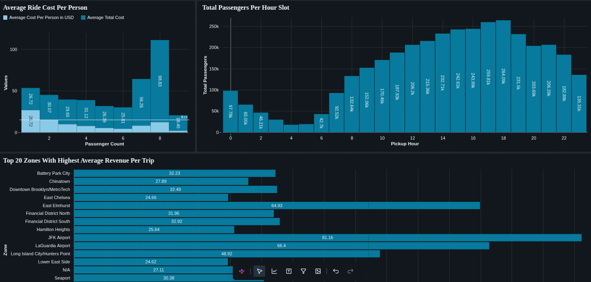

# 🚖 Hey Taxi

A modern end-to-end **Data Engineering Project** built using **Databricks, Apache Spark, Delta Lake, and Power BI** following the **Medallion Architecture (Bronze → Silver → Gold)**.

This project processes millions of New York City taxi trip records, transforms raw data into analytics-ready datasets, and produces business insights through dashboards.

👉 **[Visit Dashboard](https://dbc-abbc63ca-322f.cloud.databricks.com/dashboardsv3/01f1b76596a912d38f2d9ab07f23626c/published?o=7474652364655475)**

<p align="center">
  
</p>

---

# 📌 Project Objectives

- Build a production-style data lakehouse.
- Learn industry-standard data engineering practices.
- Process large-scale datasets efficiently using Apache Spark.
- Implement the Medallion Architecture.
- Create optimized Delta tables.
- Build interactive business dashboards.

---

# 🏗️ Architecture

```text
                 NYC Taxi Trip Data (Parquet)
                           │
                           ▼
                    Bronze Layer
              (Raw Data Ingestion)
                           │
                           ▼
                    Silver Layer
            (Cleaning & Transformations)
                           │
                           ▼
                     Gold Layer
              (Business Aggregations)
                           │
                           ▼
                 Power BI Dashboard
```

---

# 🛠 Tech Stack

| Category | Technology |
|----------|------------|
| Cloud Platform | Databricks Free Edition |
| Processing Engine | Apache Spark (PySpark) |
| Storage | Delta Lake |
| Programming Language | Python |
| SQL Engine | Spark SQL |
| Dashboard | Power BI |
| Version Control | Git & GitHub |
| Data Format | Parquet |
| Notebook Environment | Databricks Notebook |

---

# 📂 Project Structure

```text
NYC-Taxi-Analytics/
│
├── notebooks/
│   ├── 01_setup
│   ├── 02_bronze_ingestion
│   ├── 03_silver_transformation
│   ├── 04_gold_transformation
│   ├── 05_data_quality
│   ├── 06_performance_optimization
│   └── 07_dashboard_queries
│
├── data/
│
├── dashboard/
│
├── images/
│
├── README.md
│
└── requirements.txt
```

---

# 📊 Dataset

The project uses the **New York City Taxi & Limousine Commission (TLC) Trip Record Data**.

Dataset includes:

- Yellow Taxi Trips
- Pickup & Dropoff Locations
- Passenger Count
- Trip Distance
- Fare Amount
- Payment Type
- Tips
- Timestamps

---

# 🥉 Bronze Layer

Purpose:

- Store raw source data.
- Preserve original schema.
- Enable data replay and auditing.

Tasks:

- Read Parquet files
- Add ingestion timestamp
- Store as Delta Tables

Example:

```text
Bronze
-------
trip_id
pickup_datetime
dropoff_datetime
passenger_count
trip_distance
fare_amount
...
ingestion_timestamp
```

---

# 🥈 Silver Layer

Purpose:

- Clean and standardize data.

Transformations include:

- Remove duplicates
- Handle null values
- Standardize data types
- Validate timestamps
- Calculate trip duration
- Generate derived columns

Example Columns

```text
trip_duration_minutes

trip_distance_km

pickup_hour

pickup_day

pickup_month

pickup_year
```

---

# 🥇 Gold Layer

Business-ready analytical tables.

Example KPIs:

- Daily Revenue
- Monthly Revenue
- Total Trips
- Average Fare
- Average Trip Distance
- Average Trip Duration
- Peak Pickup Hours
- Peak Dropoff Zones
- Revenue by Borough
- Payment Method Analysis
- Tip Percentage Analysis

---

# 📈 Dashboard

The Power BI dashboard includes:

- Executive Summary
- Revenue Analysis
- Trip Trends
- Pickup Heat Map
- Peak Hour Analysis
- Payment Method Distribution
- Zone Performance
- Customer Insights

---

# ⚡ Performance Optimizations

Implemented optimizations include:

- Delta Lake
- Partitioning
- File Compaction
- OPTIMIZE
- VACUUM
- Z-Ordering
- Predicate Pushdown
- Column Pruning
- Caching

---

# 📋 Data Quality Checks

The pipeline validates:

- Missing values
- Duplicate trips
- Negative fares
- Invalid timestamps
- Invalid passenger counts
- Data type consistency

---

# 📚 Skills Demonstrated

- Data Engineering
- Apache Spark
- PySpark
- Delta Lake
- Medallion Architecture
- ETL / ELT
- Data Modeling
- Spark SQL
- Performance Optimization
- Data Validation
- Dashboard Development
- Cloud Data Processing

---

# 🚀 Future Improvements

- Incremental Data Loading
- Structured Streaming
- Delta Live Tables
- Unity Catalog Integration
- Databricks Workflows
- CI/CD Pipeline
- Automated Data Quality Testing
- Azure Data Factory Integration
- Airflow Orchestration

---

# 📖 Learning Outcomes

This project demonstrates how to build a scalable analytics platform capable of processing millions of records using modern cloud-native data engineering tools and best practices.

---

# 👨‍💻 Author

**MD Shoaib Tasrif Emon**

Aspiring Data Engineer | Software Engineer

GitHub: *Add your GitHub profile here*

LinkedIn: *Add your LinkedIn profile here*
